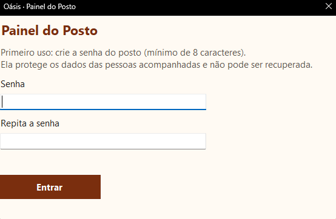
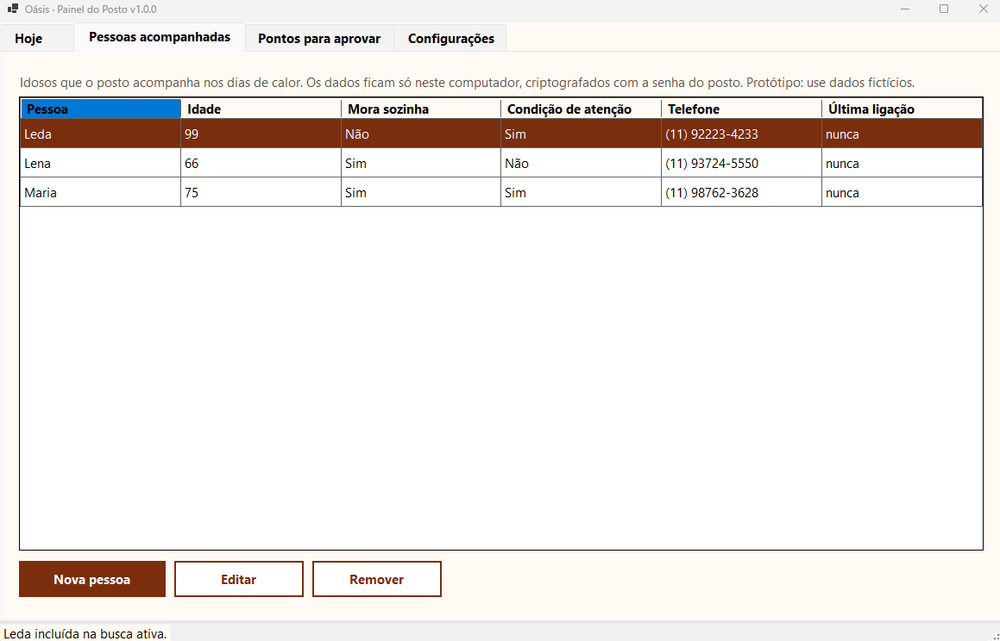
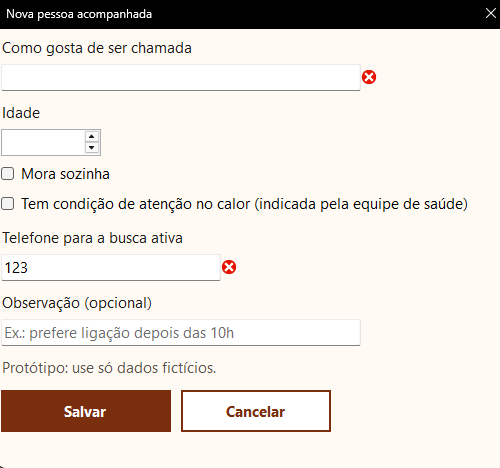
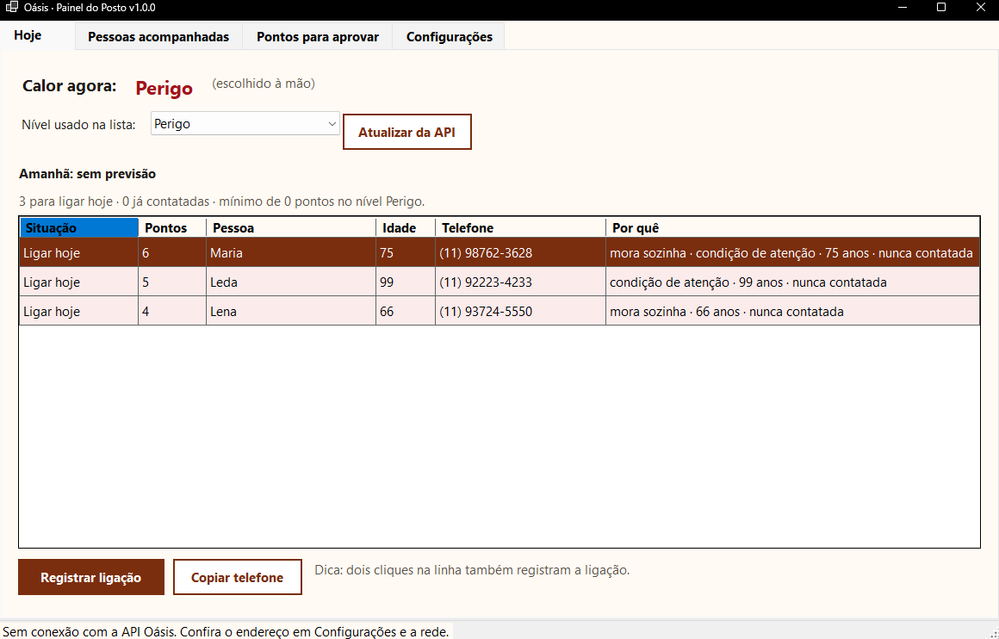
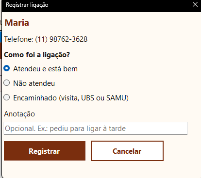
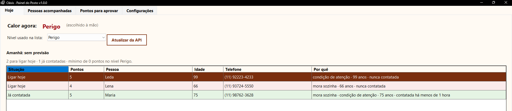
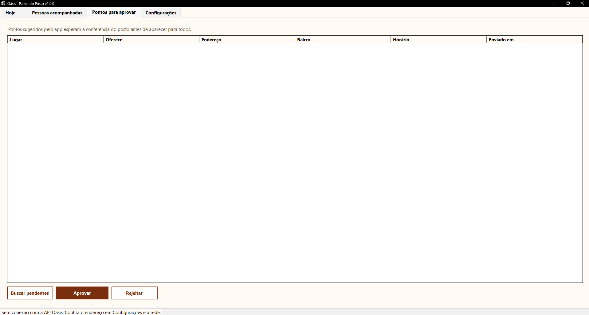
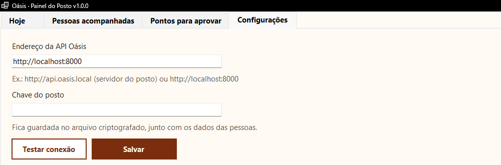

# Oásis · Painel do Posto (C# Software Development)

## Ficha da CitizenTech

| Campo | Resposta |
| --- | --- |
| **Nome da CitizenTech** | Oásis |
| **Equipe** | Belton Lee Carr De Muzio Meira · RM560760 · 3ESPA (equipe individual) |
| **Cidade e bairro** | São Paulo, Vila Mariana |
| **Cidadão beneficiado** | Idosos que moram sozinhos e trabalhadores de rua (ambulantes, entregadores, garis) |
| **Problema, em uma frase** | Nos dias de calor extremo, idosos e trabalhadores de rua não ficam sabendo a tempo que o risco está alto nem onde há água e sombra por perto. |
| **Como funciona** | Estações com sensor medem temperatura e umidade e calculam o índice de calor. Um modelo treinado com 11 anos de dados do INMET prevê se amanhã será dia de risco. O app avisa e mostra os pontos de água e sombra mais próximos, e o posto comunitário valida os pontos e prioriza quem acompanhar nos dias críticos. |
| **O que cada parte faz** | API `oasis-soa` (SOA) guarda e serve os dados e a página pública · Modelo `oasis-ia-ml` (IA & ML) prevê o risco de amanhã · Painel do Posto `oasis-csharp` (C#) aprova pontos e organiza a busca ativa · Servidor `oasis-operating-systems` (Operating Systems) hospeda a API no IIS · App (Mobile) é a porta do cidadão · Estação ESP32 (Physical) mede e sinaliza no local · Relatório de riscos (Cyber) protege a solução · ArchiMate (Testing) descreve a arquitetura |
| **Link do repositório** | https://github.com/BeltonLeeMeira/oasis-csharp |
| **Indicador de impacto** | Percentual dos dias de risco avisados na véspera (recall do modelo: 85% no teste, contra 49% sem o modelo) e percentual das pessoas acompanhadas contatadas até 12h nos dias de risco (meta: 100%) |
| **ODS conectados** | 3 (saúde: alerta precoce, meta 3.d) · 10 (redução das desigualdades, meta 10.2) · 11 (cidades: espaços públicos acessíveis, meta 11.7) · 13 (clima: resiliência e alerta precoce, metas 13.1 e 13.3) |

**Equipe:** Oásis · Belton Lee Carr De Muzio Meira · RM560760 · 3ESPA

Aplicação desktop em **Windows Forms (C#)** para o posto comunitário (UBS, associação de bairro ou ponto de atendimento). Em dia de calor, ela diz para quem o agente precisa ligar primeiro, registra cada ligação e aprova os pontos de água e sombra que os moradores sugerem pelo app.

## O problema

Nos dias de calor extremo, **idosos que moram sozinhos** correm mais risco de desidratação e exaustão pelo calor, e muitas vezes ninguém liga para saber se estão bem. O posto até tem a lista dessas pessoas, mas não sabe em que dia agir nem por onde começar.

## A pessoa real beneficiada

O Rafa tem 29 anos e é entregador de aplicativo na Zona Sul de São Paulo. Em dia de muito calor ele sai mais cedo, leva garrafa térmica no bagageiro e para em posto de gasolina para encher a garrafa. Uma vez teve um "branco" e tremedeira depois de três horas sem beber nada, e não contou para ninguém. Parar custa corrida, então notificação ele ignora: só pararia se soubesse de um ponto de apoio com água por perto.

É aí que o painel entra para ele: os pontos de água e sombra sugeridos pelos moradores só aparecem no mapa do app depois que o agente do posto aprova, na aba **Pontos para aprovar**. A conversa completa está em [`docs/entrevista.md`](docs/entrevista.md).

Dentro do posto, quem usa o painel é o **agente** que faz a busca ativa: ele abre a tela e sabe na hora para quem ligar e em que ordem. Essa ligação é voltada aos **idosos que moram sozinhos** e são acompanhados pelo posto, para que recebam o contato antes de passar mal.

## O que o painel faz

| Aba | O que faz |
| --- | --- |
| **Hoje** | Lê o nível de calor das estações na API (ou usa o nível escolhido à mão, se a internet cair) e monta a lista do dia: **Ligar hoje**, **Já contatada** ou **Opcional**, ordenada pela pontuação de risco. Mostra a previsão de amanhã do modelo de IA. Atualiza sozinho a cada minuto. |
| **Pessoas acompanhadas** | Cadastro, edição e remoção, com validação de cada campo |
| **Pontos para aprovar** | Pontos de água e sombra sugeridos pelo app; o agente aprova ou rejeita |
| **Configurações** | Endereço da API e chave do posto, com teste de conexão |

### Regras (lógica e fluxos de decisão)

- **Pontuação de 0 a 7:** +2 se mora sozinha, +2 se tem condição de atenção, +2 com 80 anos ou mais (+1 de 65 a 79), +1 se não houve contato com sucesso nas últimas 24 horas.
- **Nível do dia:** o pior entre as estações.
- **Quem precisa de ligação hoje:** no Perigo, todos; no Alerta, quem tem 3 pontos ou mais; na Atenção, 5 ou mais; no Normal, ninguém.
- **Ligação:** "Atendeu" ou "Encaminhado" contam como contato feito. "Não atendeu" mantém a pessoa em **Ligar hoje**, com o aviso "não atendeu às 10:15, tente de novo".
- **Validações:** apelido de 2 a 40 letras, idade de 60 a 120 anos, telefone no formato (11) 91234-5678, observação de até 120 caracteres.

### Persistência e privacidade

Os dados das pessoas acompanhadas são dados de saúde, sensíveis pela LGPD. Por isso:

- ficam **só neste computador** e nunca vão para a API;
- o arquivo (`%APPDATA%\Oasis\posto.dados`) é **criptografado com AES-256-GCM**, com a chave derivada da senha do posto (PBKDF2-SHA256, 600 mil iterações);
- a senha é pedida ao abrir o painel; depois de 5 erros, o painel espera 30 segundos;
- não há senha mestra: quem esquece a senha perde o arquivo (o posto recadastra).

## Programação orientada a objetos

| Classe | Responsabilidade |
| --- | --- |
| `PessoaAcompanhada` | Entidade com estado encapsulado: propriedades só de leitura, mudanças por `Atualizar()` e `RegistrarContato()`, contatos expostos como `IReadOnlyList` |
| `RegistroContato` | Registro imutável (`record`) de uma ligação |
| `ValidadorPessoa` | Regras de preenchimento, com mensagens por campo |
| `BuscaAtiva` | Pontuação, nível do dia e montagem da lista |
| `CofreDeArquivo` | Criptografia do arquivo (AES-GCM + PBKDF2) |
| `SessaoDoPosto` | Persistência: abre, guarda e salva tudo o que o posto tem |
| `ClienteApiOasis` | Conversa com a API (risco, previsão, pontos) |
| `FormSenha`, `FormPrincipal`, `FormPessoa`, `FormContato` | Telas em Windows Forms |

## Tecnologias

- C# 12 e .NET 8, Windows Forms
- `System.Text.Json` e `HttpClient` para a API
- `System.Security.Cryptography` (AES-GCM e PBKDF2) para o arquivo
- Sem pacotes NuGet de terceiros

## Estrutura

```
oasis-csharp/
├── Oasis.Posto.sln
├── Directory.Build.props        versão (1.0.0) e opções comuns
├── CHANGELOG.md                 histórico de versões (SemVer)
├── evidencias/                  telas do painel em funcionamento
├── VERSIONAMENTO.md             como as versões e os pull requests foram organizados
├── Oasis.Posto.Nucleo/          regras, dados e API (sem tela)
│   ├── Dominio/                 PessoaAcompanhada, BuscaAtiva, ValidadorPessoa, enums
│   ├── Dados/                   CofreDeArquivo, SessaoDoPosto
│   └── Api/                     ClienteApiOasis
├── Oasis.Posto.App/             Windows Forms (as telas)
└── Oasis.Posto.Testes/          22 testes do núcleo
```

## Como executar

Pré-requisitos: Windows 10 ou 11, **SDK do .NET 8 ou mais novo** (o Visual Studio 2022 já traz o 8; o Visual Studio 2026 traz o 10, que também compila este projeto) e, para a aba Hoje com dados reais, a API Oásis rodando (ver repositório `oasis-soa`).

**No Visual Studio 2022:** abra `Oasis.Posto.sln`, defina `Oasis.Posto.App` como projeto de inicialização e aperte F5.

**No terminal:**

```powershell
dotnet run --project Oasis.Posto.App
```

No primeiro uso, crie a senha do posto. Em **Configurações**, informe o endereço da API (ex.: `http://localhost:8000`) e a chave do posto (a mesma de `OASIS_CHAVE_POSTO` na API), clique em **Testar conexão** e depois em **Salvar**. Cadastre algumas pessoas fictícias e veja a lista da aba **Hoje** mudar conforme o nível de calor.

**Testes do núcleo:**

```powershell
dotnet run --project Oasis.Posto.Testes
```

## Evidências de funcionamento

Telas do painel rodando no Windows, com pessoas fictícias.

**Primeiro uso.** O painel pede a criação da senha do posto, que protege o arquivo de dados.



**Pessoas acompanhadas.** Cadastro dos idosos que o posto acompanha.



**Validação do cadastro.** Apelido em branco e telefone inválido são recusados, e o cadastro não é salvo.



**Lista do dia.** No nível Perigo, todas entram em "Ligar hoje", da maior pontuação para a menor, com o motivo de cada ponto.



**Registro de ligação.** O agente escolhe o resultado e pode anotar uma observação.



**Depois da ligação.** A pessoa passa para "Já contatada", vai para o fim da lista e perde o ponto de "nunca contatada".



**Pontos para aprovar.** Fila dos pontos de água e sombra sugeridos pelo app. A lista vem da API Oásis; na imagem ela está vazia porque a API estava desligada.



**Configurações.** Endereço da API e chave do posto, guardados no arquivo criptografado.


